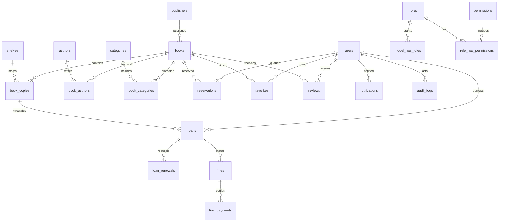

# Kiến trúc LIBRIVO

React/TypeScript/Vite → proxy `/api`, `/sanctum` → Laravel 13 + Sanctum session → MySQL 8.
Host trình duyệt thống nhất `localhost`. Không lưu token hoặc dữ liệu nghiệp vụ ở localStorage.

## Ranh giới nghiệp vụ

`books` là đầu sách, `book_copies` là từng hiện vật có barcode unique. Loan `requested → approved → active → returned`; nhánh `rejected/cancelled` kết thúc. Approved giữ copy, Active mới tính thời gian mượn. Quá hạn được suy ra từ due_at. Reservation là FIFO riêng khi không còn copy khả dụng. Khi trả, giữ copy cho người chờ hợp lệ đầu tiên. Scheduler hết hạn giữ và tiếp tục hàng chờ.

Mọi thay đổi lưu thông khóa book row rồi user/copy/loan trong transaction. Thứ tự khóa thống nhất theo book; khóa user bảo vệ hạn mức giữa các đầu sách. Các chuyển trạng thái chỉ hợp lệ một lần. Tiền VND lưu số nguyên. Không xóa lịch sử tài chính.

## Phân quyền

Guest: catalog công khai. Reader: dữ liệu sở hữu, favorites/reviews. Librarian: catalog, lưu thông, thành viên, báo cáo, thu phạt. Super Admin: mọi quyền cùng cấu hình, roles, audit. Sanctum middleware + permission middleware + model policies; API kiểm tra ownership độc lập giao diện. Không tự đăng ký role. Bảo vệ Super Admin cuối cùng.

## ERD

## API contracts

Responses: paginated collections `{data, links, meta}`; model `{data}`; validation `{message, errors}`; 401/403/404/409/422/429 errors. UTC storage, Asia/Ho_Chi_Minh display. Pagination maximum 100. Files public images only, validated MIME/size. Password reset uses Laravel broker, local mail log. SMTP optional.
