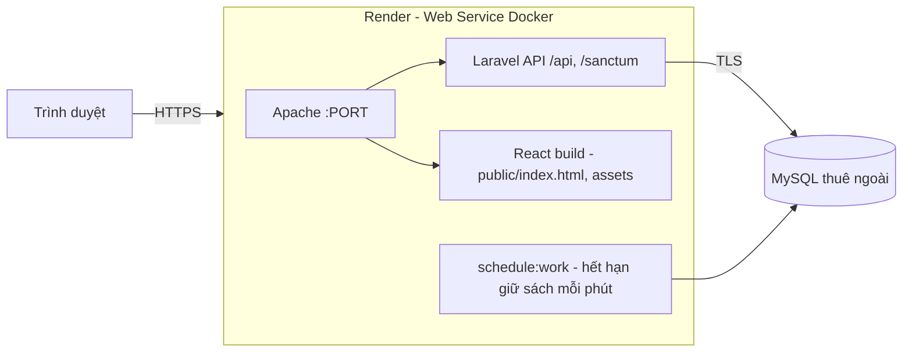

# Deploy LIBRIVO lên Render

LIBRIVO chạy trên Render như **một Web Service Docker**: Apache + PHP chạy Laravel và phục vụ luôn bản build React (cùng một domain). CSDL là **MySQL thuê ngoài**, vì Render chỉ có PostgreSQL và code dùng hàm riêng của MySQL (`DATE_FORMAT` ở [AdminController.php](../backend/app/Http/Controllers/Api/AdminController.php)).

## 1. Chuẩn bị MySQL

Cần một MySQL 8 truy cập được từ internet qua TLS. Lấy 5 giá trị: `DB_HOST`, `DB_PORT`, `DB_DATABASE`, `DB_USERNAME`, `DB_PASSWORD`.

| Nhà cung cấp | Ghi chú (tra cứu 25/11/2026, hãy kiểm tra lại trang giá trước khi dùng) |
|---|---|
| **TiDB Cloud Starter** | Có gói free, tương thích giao thức MySQL nhưng **không phải MySQL thật**. Test đồng thời của repo chỉ chạy trên MySQL 8.0.44, nên phải tự thử luồng mượn/trả sau khi deploy. |
| **Aiven for MySQL (Developer)** | MySQL thật, khoảng 5 USD/tháng. **Gói free MySQL của Aiven đã đóng**: không tạo mới từ 6/11/2026. Aiven dùng CA riêng, xem mục "Biến môi trường" (`DB_SSL_CA_PEM`). |
| MySQL tự thuê (VPS, hosting) | Phải mở cổng 3306 ra ngoài và bật TLS. |

Tạo sẵn một database rỗng (ví dụ `librivo`). Migration và dữ liệu demo do container tự nạp khi khởi động.

## 2. Tạo dịch vụ trên Render

1. Đẩy code lên GitHub (nhánh `main`).
2. Render dashboard → **New** → **Blueprint** → chọn repo → Render đọc [render.yaml](../render.yaml).
3. Render hỏi 5 biến để trống: `DB_HOST`, `DB_PORT`, `DB_DATABASE`, `DB_USERNAME`, `DB_PASSWORD`. Điền vào rồi bấm **Apply**.
4. Chờ build (vài phút). Mở tab **Logs**, lần đầu sẽ thấy `CSDL trống, nạp dữ liệu demo...`, sau đó `Khởi động Apache`.
5. Mở `https://<tên-dịch-vụ>.onrender.com`.

Từ lần sau, mỗi lần push lên `main` Render tự build và deploy lại (`autoDeploy: true`).

## 3. Biến môi trường

| Biến | Nguồn | Ý nghĩa |
|---|---|---|
| `APP_KEY` | Render tự sinh | Khoá mã hoá. Đổi giá trị sẽ làm mọi phiên đăng nhập hết hiệu lực. |
| `APP_URL`, `FRONTEND_URL` | Tự lấy từ `RENDER_EXTERNAL_URL` | URL công khai. Đặt tay nếu dùng domain riêng. |
| `SANCTUM_STATEFUL_DOMAINS` | Tự lấy từ `RENDER_EXTERNAL_HOSTNAME` | Phải đúng host của website (không kèm `https://`). Sai thì đăng nhập báo **419**. |
| `DB_*` | Bạn nhập | Thông tin MySQL. |
| `MYSQL_ATTR_SSL_CA` | `render.yaml` | Mặc định là CA hệ thống, đủ cho nhà cung cấp dùng chứng chỉ công khai. |
| `DB_SSL_CA_PEM` | Bạn thêm nếu cần | Dán nội dung file CA (PEM) của nhà cung cấp dùng CA riêng như Aiven. Khi có biến này, container ghi ra file và tự đặt `MYSQL_ATTR_SSL_CA`. Nhớ xoá dòng `MYSQL_ATTR_SSL_CA` trong `render.yaml`. |
| `SEED_ON_BOOT` | `true` | Nạp dữ liệu demo khi CSDL chưa có sách. Đã có sách thì bỏ qua, không ghi đè. |
| `LOG_CHANNEL=stderr` | `render.yaml` | Log Laravel hiện trong tab Logs. |

## 4. Kiểm tra sau khi deploy

1. `https://<host>/up` trả `200`.
2. Mở trang chủ, vào `/catalog`, tải lại trang (F5) vẫn thấy trang, không báo 404.
3. Đăng nhập tài khoản Super Admin (xem [README](../README.md)).
4. Mở **Dashboard**. Đây là chỗ dùng `DATE_FORMAT`, nếu CSDL không phải MySQL đủ tương thích sẽ báo lỗi ở đây.
5. Chạy thử một luồng đầy đủ: yêu cầu mượn → duyệt → bàn giao → trả.

## 5. Hạn chế khi dùng gói free

Theo [tài liệu Render](https://render.com/docs/free):
- Dịch vụ **ngủ sau 15 phút không có request**, lần mở đầu tiên chờ tới khoảng 1 phút. Mỗi lần thức dậy container chạy lại `entrypoint.sh` (migrate, kiểm tra dữ liệu).
- Có 750 giờ chạy miễn phí mỗi tháng cho mỗi workspace.
- **Hệ thống file là tạm thời**: ảnh bìa và avatar mới upload sẽ mất khi dịch vụ restart hoặc deploy lại. Ảnh bìa mặc định nằm trong repo nên không mất.
- Scheduler (`schedule:work`) chỉ chạy lúc dịch vụ đang thức, nên giữ chỗ hết hạn có thể xử lý trễ khi dịch vụ ngủ.
- Mail đang ghi vào log (`MAIL_MAILER=log`): link đặt lại mật khẩu xem trong tab Logs.

## 6. Bảo mật trước khi chia sẻ link

- **Đổi mật khẩu** các tài khoản demo (`admin@`, `librarian@`, `reader@librivo.local`). Mật khẩu của chúng công khai trong README.
- Không đưa mật khẩu MySQL vào repo. Chỉ nhập trong dashboard Render.

## 7. Sự cố thường gặp

| Triệu chứng | Nguyên nhân thường gặp |
|---|---|
| Đăng nhập báo 419 | `SANCTUM_STATEFUL_DOMAINS` không khớp host đang truy cập. |
| Container thoát với "Thiếu biến DB_..." | Chưa điền đủ 5 biến `DB_*`. |
| "Không migrate được sau 6 lần" | Sai host/port/user/mật khẩu, hoặc MySQL chưa cho phép IP của Render, hoặc lỗi TLS (xem `DB_SSL_CA_PEM`). |
| Lỗi 500 | Xem tab Logs. Tạm đặt `LOG_LEVEL=debug` để thấy chi tiết (đừng bật `APP_DEBUG` trên site công khai). |
| Build lỗi ở bước `npm install` | Xem log build. `package-lock.json` hiện lệch nên Dockerfile dùng `npm install` thay cho `npm ci`. |
