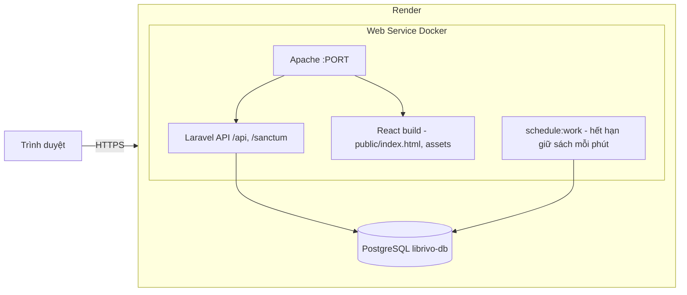

# Deploy LIBRIVO lên Render

LIBRIVO chạy trên Render như **một Web Service Docker**: Apache + PHP chạy Laravel và phục vụ luôn bản build React (cùng một domain). CSDL là **PostgreSQL do Render quản lý**, khai báo sẵn trong [render.yaml](../render.yaml), không cần tài khoản dịch vụ nào khác.

Code chạy được trên cả PostgreSQL, MySQL và SQLite. Các truy vấn riêng của từng CSDL (nhóm theo tháng/ngày, tìm kiếm không phân biệt hoa thường) nằm ở [SqlDate.php](../backend/app/Support/SqlDate.php) và `whereLike`.

## 1. Tạo dịch vụ trên Render

1. Đẩy code lên GitHub (nhánh `main`).
2. Render dashboard → **New** → **Blueprint** → kết nối GitHub và chọn repo. Render đọc `render.yaml` và đề xuất tạo `librivo` (Web Service) cùng `librivo-db` (PostgreSQL).
3. Bấm **Apply**. Không có biến nào phải tự nhập.
4. Chờ build (vài phút). Mở tab **Logs** của `librivo`: lần đầu sẽ thấy `CSDL trống, nạp dữ liệu demo...`, sau đó `Khởi động Apache`.
5. Mở `https://<tên-dịch-vụ>.onrender.com`. Link thật hiện ở đầu trang dịch vụ.

Từ lần sau, mỗi lần push lên `main` Render tự build và deploy lại (`autoDeploy: true`).

## 2. Biến môi trường

| Biến | Nguồn | Ý nghĩa |
|---|---|---|
| `DB_CONNECTION` | `render.yaml` (`pgsql`) | Loại CSDL. |
| `DB_URL` | Tự lấy từ `librivo-db` | Chuỗi kết nối Postgres nội bộ của Render. |
| `APP_KEY` | Render tự sinh | Khoá mã hoá. Đổi giá trị sẽ làm mọi phiên đăng nhập hết hiệu lực. |
| `APP_URL`, `FRONTEND_URL` | Tự lấy từ `RENDER_EXTERNAL_URL` | URL công khai. Đặt tay nếu dùng domain riêng. |
| `SANCTUM_STATEFUL_DOMAINS` | Tự lấy từ `RENDER_EXTERNAL_HOSTNAME` | Phải đúng host của website (không kèm `https://`). Sai thì đăng nhập báo **419**. |
| `SEED_ON_BOOT` | `true` | Nạp dữ liệu demo khi CSDL chưa có sách. Đã có sách thì bỏ qua, không ghi đè. |
| `LOG_CHANNEL=stderr` | `render.yaml` | Log Laravel hiện trong tab Logs. |

### Dùng MySQL thay cho Postgres (tuỳ chọn)

Xoá khối `databases:` và biến `DB_URL` trong `render.yaml`, đặt `DB_CONNECTION=mysql`, rồi khai báo `DB_HOST`, `DB_PORT`, `DB_DATABASE`, `DB_USERNAME`, `DB_PASSWORD` (đánh dấu `sync: false`) cho MySQL thuê ngoài. Nhà cung cấp dùng CA riêng thì dán nội dung PEM vào biến `DB_SSL_CA_PEM`; nhà cung cấp dùng chứng chỉ công khai thì đặt `MYSQL_ATTR_SSL_CA=/etc/ssl/certs/ca-certificates.crt`. Gói free MySQL của Aiven đã đóng từ 6/11/2026.

## 3. Kiểm tra sau khi deploy

1. `https://<host>/up` trả `200`.
2. Mở trang chủ, vào `/catalog`, tải lại trang (F5) vẫn thấy trang, không báo 404.
3. Đăng nhập tài khoản Super Admin (xem [README](../README.md)).
4. Mở **Dashboard** và thử đổi kỳ 7/30/90/365 ngày.
5. Chạy thử một luồng đầy đủ: yêu cầu mượn → duyệt → bàn giao → trả.

## 4. Hạn chế khi dùng gói free

Theo [tài liệu Render](https://render.com/docs/free):
- **Postgres miễn phí hết hạn sau 30 ngày kể từ lúc tạo**, dung lượng 1 GB, không có sao lưu. Hết hạn bạn có thêm 14 ngày để nâng cấp lên gói trả phí, sau đó CSDL bị xoá. Mỗi workspace chỉ có một Postgres free.
- Web Service **ngủ sau 15 phút không có request**, lần mở đầu tiên chờ tới khoảng 1 phút. Mỗi lần thức dậy container chạy lại `entrypoint.sh` (migrate, kiểm tra dữ liệu).
- Có 750 giờ chạy miễn phí mỗi tháng cho mỗi workspace.
- **Hệ thống file là tạm thời**: ảnh bìa và avatar mới upload sẽ mất khi dịch vụ restart hoặc deploy lại. Ảnh bìa mặc định nằm trong repo nên không mất.
- Scheduler (`schedule:work`) chỉ chạy lúc dịch vụ đang thức, nên giữ chỗ hết hạn có thể xử lý trễ khi dịch vụ ngủ.
- Mail đang ghi vào log (`MAIL_MAILER=log`): link đặt lại mật khẩu xem trong tab Logs.

## 5. Bảo mật trước khi chia sẻ link

- **Đổi mật khẩu** các tài khoản demo (`admin@`, `librarian@`, `reader@librivo.local`). Mật khẩu của chúng công khai trong README.
- Không đưa mật khẩu CSDL vào repo. Với Postgres của Render, chuỗi kết nối do Render tự cấp.

## 6. Đã kiểm chứng gì

| Mục | Kết quả |
|---|---|
| Bộ test backend trên SQLite | 37/37 đạt |
| Cùng bộ test trên PostgreSQL 17 thật | 37/37 đạt, 7 migration chạy đủ |
| Seed dữ liệu demo trên PostgreSQL | 100 sách, 300 bản sao, 37 người dùng, 253 lượt mượn |
| API trên PostgreSQL | Dashboard 4 kỳ, tìm kiếm không phân biệt hoa thường, đăng nhập, `DB_URL` kiểu Render |
| Build image Docker, Apache, `entrypoint.sh` trong container Linux | **Chưa kiểm** (máy phát triển không có Docker). Lỗi nếu có sẽ hiện ở log build đầu tiên trên Render |
| Test tranh chấp khoá dòng (`tests/Mysql`) | Chỉ viết cho MySQL, chưa chạy trên Postgres |

## 7. Sự cố thường gặp

| Triệu chứng | Nguyên nhân thường gặp |
|---|---|
| Đăng nhập báo 419 | `SANCTUM_STATEFUL_DOMAINS` không khớp host đang truy cập. |
| Container thoát với "Chưa có DB_URL..." | `DB_URL` không được gắn từ `librivo-db`. Kiểm tra tên database trong `render.yaml`. |
| "Không migrate được sau 6 lần" | Postgres chưa sẵn sàng, hoặc Postgres đã hết hạn (xem mục 4). |
| Lỗi 500 | Xem tab Logs. Tạm đặt `LOG_LEVEL=debug` để thấy chi tiết (đừng bật `APP_DEBUG` trên site công khai). |
| Build lỗi ở bước `npm install` | Xem log build. `package-lock.json` hiện lệch nên Dockerfile dùng `npm install` thay cho `npm ci`. |
